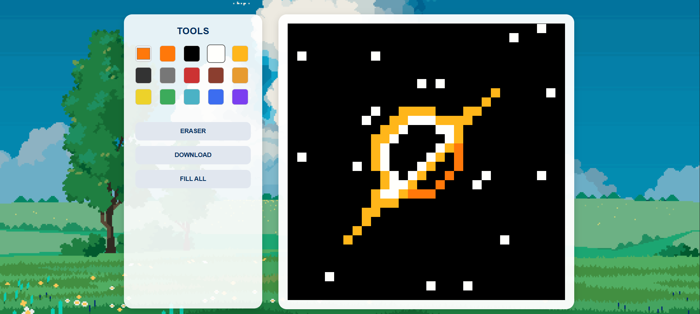

# Pixel Art Maker

A web-based pixel art editor. Pick a color, click cells on a 30 × 30 grid to paint, and download your artwork as a PNG.

**Live demo:** https://pixel-art-maker-bf0i.onrender.com/

> The demo is hosted on Render. If it has been idle, the first load may take a few seconds to wake up.



## Features

- **30 × 30 canvas** with a checkerboard background so empty cells are easy to see
- **Click to paint**, or **double-click and drag** to paint continuously
- **Color picker** for any custom color
- **Recent colors palette** of 14 swatches. Colors you pick are added to the front and older ones shift down
- **Eraser** that restores a cell to its original checkerboard shade
- **Fill All** to fill the whole canvas with the selected color
- **Download** your artwork as `pixelArt.png`

## How to use

1. Choose a color from the palette or the color picker.
2. Click a cell to paint it. To paint continuously, double-click a cell, then move the mouse across the grid. Release the mouse button to stop.
3. Select **Eraser** to clear cells. Pick any color to switch back to painting.
4. Select **Fill All** to fill the canvas with the current color.
5. Select **Download** to save the grid as a PNG.

## Tech stack

- HTML, CSS and vanilla JavaScript, with no build step
- [html2canvas](https://html2canvas.hertzen.com/) (loaded from a CDN) to export the grid as an image

## Project structure

```
.
├── index.html    # Page layout
├── styles.css    # Styling
├── script.js     # Drawing logic, palette, eraser, fill, download
└── imgs/         # Logo and background image
```

## Run locally

No installation is needed. Clone the repository and open `index.html` in a browser.

```bash
git clone <your-repo-url>
cd pixel-art-maker
```

The page loads html2canvas from a CDN, so you need an internet connection for the download button to work.

## My contribution

- Implemented the JavaScript drawing logic
- Added mouse-drag painting on double-click
- Added color selection
- Added the download feature

## Team contribution

- HTML layout
- CSS styling

## What I learned

- DOM manipulation
- UI state management
- Collaborating in a team project

## Acknowledgements

Created as a semester 1 academic project at IIIT Kottayam, under the guidance of Dr. Goutam Mali, Assistant Professor.
